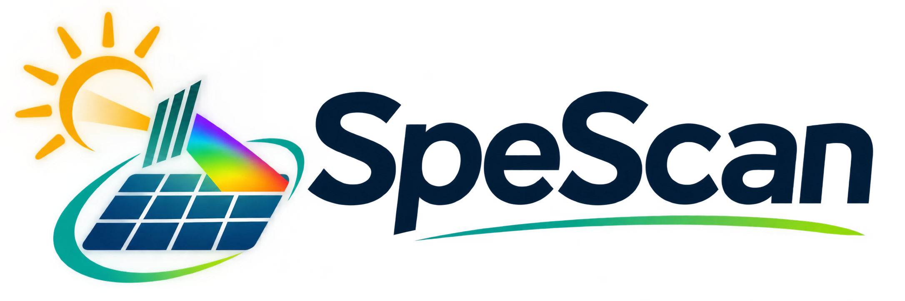
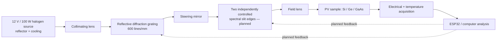

# SpeScan-PV

**Intelligent spectral–electrical characterization of photovoltaic cells**



**Project stage:** Pre-MVP · ESP32 firmware prototype · Optical hardware integration and experimental validation pending  
**Research materials:** Silicon (Si), germanium (Ge), and gallium arsenide (GaAs) photovoltaic **samples**, evaluated separately.

## What is SpeScan?

SpeScan is a research-stage optoelectronic platform intended to investigate how **controlled spectral illumination** affects the electrical output and temperature of different photovoltaic materials. The proposed instrument will select an optical wavelength band, illuminate a photovoltaic sample, and record synchronized electrical and thermal measurements.

**Long-term vision:** Use validated, material-specific spectral data to inform the design and testing of **selective optical filters** that transmit useful sunlight while reducing absorption of radiation that contributes to unnecessary heating. The filters are a *future research goal*, not a completed or validated product.

> **Scientific integrity:** A firmware demonstration is not a calibrated spectrometer. The repository currently provides experimental ESP32 control/measurement code; a complete two-edge spectral selection instrument, reliable EQE/SR data, calibrated I–V curves, and material-specific filter performance have **not** been established by the files in this repository.

## The problem

Photovoltaic materials respond differently to the same spectral illumination. Optical conditions and cell temperature affect current, voltage, and power. Existing measurement methods can characterize spectral response and I–V curves, but SpeScan specifically proposes a laboratory workflow that links **controllable spectral-band boundaries** with **simultaneous electrical and thermal characterization** of individual PV samples.

There is no single universally optimal filter for Si, Ge, and GaAs. Each material must be investigated separately, and any filter must be evaluated against **net electrical energy production**, not temperature reduction alone.

## Proposed optical measurement chain



The reflective grating disperses incident light; the adjustable slit is intended to choose the **lower and upper wavelength bounds** independently. The field lens directs the selected band toward the designated sample area. The actual beam geometry, spectral throughput, uniformity, and edge sharpness must be verified in optical modeling and laboratory calibration.

**Important distinction:** Rotating a grating to choose a central wavelength is **not equivalent** to independently controlling both edges of a spectral band. The latter requires additional controlled optics and software that are **planned**, rather than demonstrated by the current firmware.

See [Optical concept and limitations](docs/OPTICAL_DESIGN.md).

## What this repository currently contains

The existing repository provides an ESP32 firmware baseline and supporting notes:

| Existing item | Documented function | Evidence boundary |
| --- | --- | --- |
| `firmware/SpeScanPV_ESP32/SpeScanPV_ESP32.ino` | Servo-controlled wavelength scan, voltage/current acquisition and CSV reporting | Firmware is a prototype; physical measurement accuracy not established |
| `docs/WIRING.md` | Existing wiring/power notes | Review against actual electrical build before using |
| `docs/CALIBRATION.md` | Existing wavelength calibration guidance | Placeholder wavelength–servo points must be replaced with measured calibration |
| `data/sample_output.csv` | Example serial output data structure | **Illustrative data, not validated experimental results** |

The previously documented firmware uses an **ESP32**, **INA219** voltage/current sensor, **servo motor**, and optional **Nextion** display. Its *nominal* wavelength commands cover **400–1100 nm**, but the wavelength-to-servo conversion includes placeholder anchors. This is a **software scan range, not a verified optical coverage specification**.

A future precision measurement chain may evaluate INA226, a precision shunt/amplifier and ADC, but those parts should not be described as installed or operational until implemented and tested.

## PV samples and research plan

| Material | Approximate room-temperature band gap | Approximate intrinsic long-wavelength threshold | Scope |
| --- | ---: | ---: | --- |
| Si | 1.12 eV | 1,107 nm | Reference PV sample; characterize power and temperature under controlled bands |
| Ge | 0.66 eV | 1,879 nm | Evaluate its longer-wavelength response; optical range extension likely required |
| GaAs | 1.42 eV | 873 nm | Characterize direct-band-gap material under controlled spectral bands |

These are **approximate band-gap thresholds**, not measured EQE/SR cutoffs or guaranteed operating limits. Real spectral response depends on cell architecture, temperature, contacts and optics.

**Limitation:** The firmware's nominal 400–1100 nm scan does **not** cover the full possible near-infrared response of Ge. Extending measurements will require reviewing source spectrum, grating, filters, optical materials, reference detectors and electronics.

## What is measured—and what is calculated?

At each optical setting, the system aims to record voltage **U**, current **I**, cell temperature **T**, optical settings, time and (after calibration) incident optical power.

- **Electrical load power:** `P_el = U × I` (for the measured DC operating point).
- **Spectral responsivity:** `R(λ) = I_ph(λ) / P_opt(λ)` in A/W, where optical power must be measured or calibrated at the sample plane.
- **Finite-band photocurrent model:** `I_ph = ∫[λ1,λ2] R(λ) · P_λ(λ) dλ` under suitable linear-response and defined operating conditions.
- **I–V curve / maximum power point:** requires multiple controlled electrical operating points (e.g. an electronic load); a fixed-load current/voltage reading **does not** by itself establish a complete I–V curve or MPP.

Photocurrent is not automatically equal to the delivered load current. No efficiency, uncertainty or response-time improvement should be asserted without calibrated measurements and a defined comparison.

## Getting started with the existing ESP32 firmware

**Requirements:** Arduino IDE, ESP32 board package, `Adafruit INA219`, and `ESP32Servo` libraries. Confirm your exact board and I/O pins against the existing firmware and wiring documentation; hardware configurations are not interchangeable.

1. Open `firmware/SpeScanPV_ESP32/SpeScanPV_ESP32.ino` in Arduino IDE.
2. Select the matching ESP32 board and port, then inspect the pin assignments and supply voltages.
3. Compile and upload only after reviewing the wiring, servo power and lamp safety notes.
4. Open the serial monitor at **115200 baud**.
5. Use the commands documented in the current firmware:

```text
STATUS      show device/command status
MEASURE     take a sample at the programmed test wavelength
GOTO:650    move to a requested nominal wavelength and measure
START       begin nominal wavelength scan
STOP        request scan stop
```

**Do not report the displayed wavelength as calibrated** unless the wavelength–angle relation has been measured. Operating the light source and moving optics requires appropriate mechanical and electrical safety protections.

## Validation and data integrity

Before reporting optical or material-specific results:

1. Calibrate wavelength against a traceable or independently verified optical reference.
2. Measure the actual spectral optical power at the sample plane; check diffraction-order overlap and stray light.
3. Calibrate electrical and temperature channels and document uncertainty.
4. Verify illumination uniformity, repeated measurements and stable sample temperature.
5. For I–V/MPP work, add and validate an appropriate controlled-load measurement method.
6. Compare **filtered versus unfiltered** electricity production under equivalent irradiance and thermal boundary conditions before claiming filter benefits.

Details: [Measurement and validation plan](docs/VALIDATION_PLAN.md).

## Development roadmap

- **Available baseline:** ESP32 firmware structure, nominal spectral scan commands, voltage/current acquisition and CSV output as documented.
- **Under development:** optical layout with reflective diffraction grating, aligned sample stage, independent spectral-band edges, synchronized temperature measurement, calibrated optical power and integrated PC/HMI software.
- **Next experiments:** build the laboratory instrument, perform wavelength/power calibration, validate I–V measurements and uncertainty, then measure Si, Ge and GaAs **separately**.
- **Long-term research:** design and test material-specific selective optical filters; evaluate electrical and thermal performance together.

See [Roadmap](docs/ROADMAP.md).

## Potential users and future business directions

The platform is intended for research universities, PV characterization laboratories and specialized solar-cell developers. Possible future business models are instrument sales, laboratory spectral-testing services and licensing of validated filter designs. **No product prices, customers, revenue or market-size estimates are claimed here.**

## Team

| Member | Role (StartupBase profile) |
| --- | --- |
| Sanzhar Zokirov | Team Leader & Product Manager |
| Malokhat Burkhonova | Product Manager |
| Odinakhon Ragimjanova | Data Engineer |
| Mardonbek Egamberdiyev | Frontend Developer |

## Safety

The **proposed 12 V / 100 W halogen lamp** can draw roughly 8.3 A at nominal power and presents severe **heat, glare and burn** hazards. Use a rated supply, proper fuse, ceramic holder, ventilated enclosure and suitable eye protection; never look into the beam. Do not power a high-current servo or lamp from ESP32 pins. Keep optics and metalwork at safe operating temperatures. Follow the actual lamp's manufacturer documentation.

The old README referred to a **1000 W** lamp; that value does **not** match the current proposed 12 V / 100 W lamp selection and is not a verified description of assembled hardware.

## Documentation

- [Optical system concept](docs/OPTICAL_DESIGN.md)
- [Validation plan](docs/VALIDATION_PLAN.md)
- [Research & development roadmap](docs/ROADMAP.md)
- [How to apply these documentation updates](docs/UPDATE_GUIDE_UZ.md)
- Existing files: [`docs/WIRING.md`](docs/WIRING.md), [`docs/CALIBRATION.md`](docs/CALIBRATION.md)

## License

MIT License — see [`LICENSE`](LICENSE) in the original repository. Verify rights and licenses for any later-added diagrams or images.
